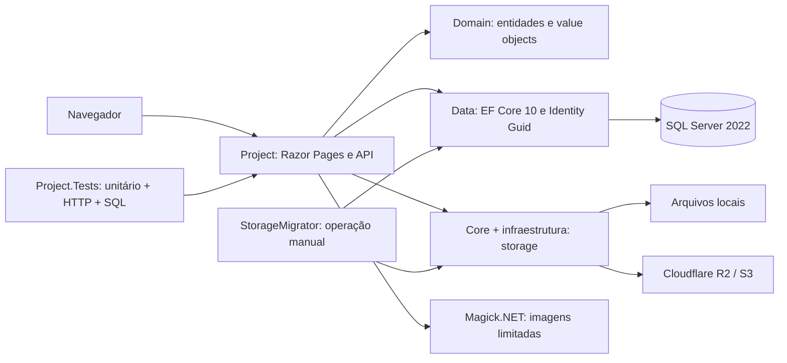

# Arquitetura atual

Atualizado em 05/11/2026. Referência: branch local `feat/unified-cicd-deployment`, base fonte `162602a`, CI/CD preservado `bcabccd`/`cabe741`, evidência publicada `fb8a205`.

O sistema é um monólito ASP.NET Core 10/Razor Pages. O site público consulta estoque e lojas; a administração usa cookies Identity, perfis e antiforgery. A API mantém GET público e exige política administrativa para escrita. Regras e validações ficam em features/MediatR e em PageModels; o EF é usado diretamente, sem camada artificial de repositórios.

| Componente | Responsabilidade |
|---|---|
| `Project` | Páginas, API, autorização, CQRS leve, catálogo, JSON-LD, processamento de imagens e worker de importação. |
| `Domain` | Veículo, loja, vendedor, marcas, mídia, importações e value objects; CNPJ opcional com validação no cadastro. Usuário usa Identity com GUID. |
| `Data` | DbContext, configurações, migrations, factory independente de startup e seed de desenvolvimento opt-in. |
| `Core` | Contratos, referências/normalização de paths e adaptação S3/R2. |
| `StorageMigrator` | CLI manual para migração de arquivos; não é executada pelo deploy e exige configuração/autorização próprias. |
| `Project.Tests` | Validações/handlers, regressões, HTTP real com Identity, SQL Server e contratos storage com dublês. |
| `scripts` e `deploy` | Manifests, integridade, auditoria, imagem, transporte SSH, executor, health e rollback. |

.NET/EF/Identity estão alinhados em 10.0.13; SDK 10.0.402. MediatR/FluentValidation preservam as APIs compatíveis já usadas. SQL Server, schema e URLs legadas foram mantidos. Magick.NET substitui ImageSharp e aceita apenas raster JPEG/PNG/WebP, limita entrada/pixels, orienta e remove metadados antes de publicar.

As consultas públicas usam `AsNoTracking`, projeções e paginação com ordenação estável. Zero km usa `!Seminovo`, conforme Release; ano isoladamente não determina a condição. Lojas públicas usam projeção tolerante a NULL legado sem hidratar value objects inválidos. Mídias preservam URLs antigas e fazem fallback quando o arquivo não existe. O índice único filtrado impede duas capas por veículo; seleção de capa ocorre em transação.

Importações persistem jobs, itens, tentativas, locks e histórico no SQL. Recuperação automática de jobs é desabilitada por padrão. Os testes usam fontes/storage falsos; não se acessa o R2 produtivo para validar uploads.

O startup em produção nunca aplica migrations nem guardas reparadores de schema. Correções de schema recuperadas foram convertidas em migrations/SQL revisáveis. O health `/health` é de processo; `/health/release` comprova o commit configurado. Esses endpoints não certificam conectividade com SQL/R2; os testes funcionais verificam essas dependências separadamente.

Limites atuais: não há atualização de schema automática, rollback de banco, sandbox R2 provisionado ou execução comprovada de GitHub Actions remoto. A arquitetura continua um monólito com camadas parcialmente acopladas, adequado à recuperação sem reescrita estrutural.
